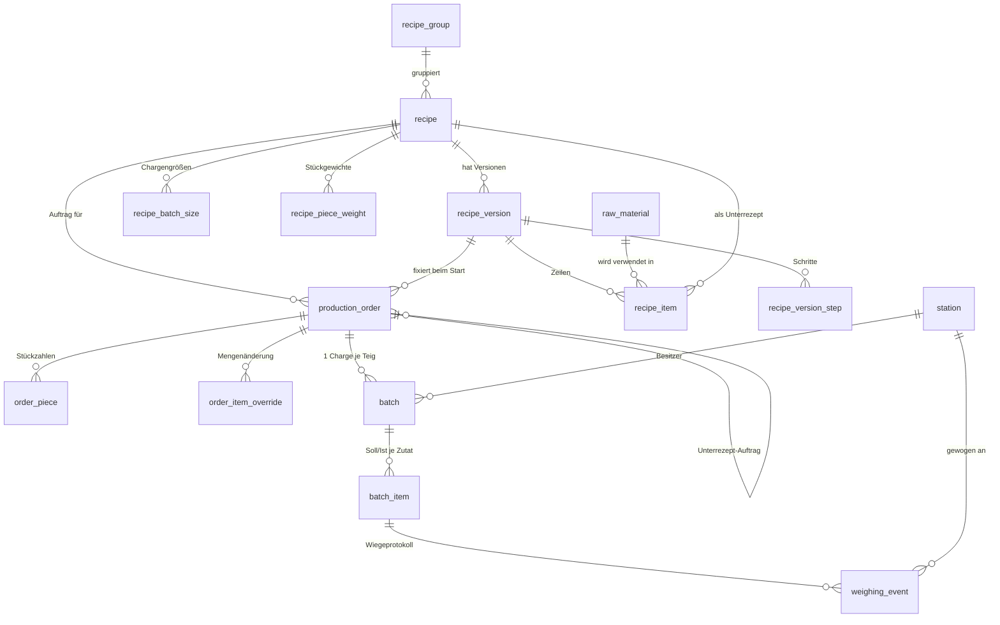

# Modul 02 – Datenbank & Datenmodell (Schritt B: Konzept)

Status: **freigegeben am 13.11.2026 durch Michael** (mit den Antworten zu K1–K6, Abschnitt 10); ergänzt um Stückgewichte und Knetzeit (M02-12, M02-13) am 13.11.2026 und um zwei Sperren für abgeschlossene Aufträge und die Versionsprüfung beim Anlegen (Freigabebericht B1, B3) am 14.11.2026
Grundlage: Entscheidungen M02-1 bis M02-11 und K1–K6 vom 13.11.2026 (PROJEKTSTATUS.md, Abschnitt 3), docs/architektur.md, docs/bedienkonzept.md

## 1. Ziel und Abgrenzung

Modul 02 legt fest, **wie** Daten gespeichert werden: Tabellen, Schlüssel, Beziehungen, Regeln für Datenintegrität, Versionierung und Migrationen.

Nicht Teil von Modul 02:

| Thema | Modul |
|---|---|
| Bedienung und Pflege der Rohstoffe | 03 |
| BÄKO-Import, Lieferanten, Allergene, Nährwerte, Zutatenverzeichnis | 03/04 (nach Sichtung Datenlink, per Migration ergänzt) |
| Bedienung Rezepte (anlegen, kopieren, sperren) | 05 |
| Berechnung, Skalierung, Rundung, Aufteilung in ganze Einheiten + Rest | 06 |
| Wiegeablauf, Quittieren, Tara, Pause | 09 |
| Chargennummer-Format, Auswertung, Aufbewahrung | 11 |
| PIN-Prüfung, Sitzungen | 12 |
| Sicherung auf QNAP, Wiederherstellung | 13 |

Modul 02 liefert: Datenbankverbindung, Migrationsmechanismus, das erste Schema (`0001_initial.sql`) und Tests für Schema und Integrität. Tabellenspezifische Lese-/Schreibfunktionen entstehen in den jeweiligen Fachmodulen.

## 2. Technische Grundlagen (M02-11)

| Punkt | Festlegung |
|---|---|
| Datenbank | SQLite, Python-Standardmodul `sqlite3`, kein ORM |
| Datei | `/data/rezeptbuch.db` (persistentes Add-on-Verzeichnis, wird vom HA-Backup erfasst) |
| Einstellungen je Verbindung | `PRAGMA foreign_keys = ON`, `PRAGMA journal_mode = WAL`, `PRAGMA busy_timeout = 5000` |
| Zugriff | ausschließlich über den Rezeptserver (Add-on `rezeptbuch`) |
| Gewichte | **ganze Gramm** (`INTEGER`), keine Kommazahlen (M02-3) |
| Prozentwerte | ganze Zahl in **Zehntelprozent** (z. B. 25 = 2,5 %), keine Kommazahlen (K2) |
| Nummern | Rohstoff- und Rezeptnummern als **ganze Zahlen** (K5) |
| Zeitpunkte | Text im Format ISO 8601 mit Zeitzone UTC, z. B. `2026-11-13T17:30:00Z`; Anzeige in Ortszeit |
| Ja/Nein-Felder | `INTEGER` 0/1 mit Prüfung |
| Schlüssel | technische ID `id INTEGER PRIMARY KEY` je Tabelle; fachliche Nummern (Rohstoffnummer, Rezeptnummer) zusätzlich eindeutig |
| Bezeichner | Englisch, snake_case (Modul 01) |

## 3. Übersicht der Tabellen

```
Stammdaten            Rezepte                         Produktion                  System
──────────            ───────                         ──────────                  ──────
raw_material ◄──┐     recipe_group                    production_order            setting
station         │     recipe ──────────┐              order_piece                 change_log
                │     recipe_version ◄─┘              order_item_override         migration_log
                │     recipe_version_step             batch (Charge = 1 Teig)
                └──── recipe_item                     batch_item (Soll/Ist)
                      recipe_piece_weight             weighing_event
                      recipe_batch_size
```

Beziehungen (vereinfacht):



## 4. Tabellen im Detail

Spaltenangaben: **PK** Primärschlüssel, **FK** Fremdschlüssel, **NN** Pflichtfeld, **U** eindeutig.

### 4.1 Stammdaten

**`station`** – Waagestationen (Waage 1, Waage 2)

| Spalte | Typ | Regeln | Bedeutung |
|---|---|---|---|
| id | INTEGER | PK | 1 oder 2 |
| name | TEXT | NN | „Waage 1“ |
| active | INTEGER | NN, 0/1 | Station eingerichtet |

Technische Waagenparameter (IP, Port, Profil) bleiben in der Konfiguration des Add-ons `rezeptbuch_waage`, nicht in der Datenbank.

**`raw_material`** – Rohstoffstamm, schlanke Startversion (M02-5)

| Spalte | Typ | Regeln | Bedeutung |
|---|---|---|---|
| id | INTEGER | PK | technische ID |
| number | INTEGER | NN, U, > 0 | Rohstoffnummer, mit der das System arbeitet |
| name | TEXT | NN | Bezeichnung |
| type | TEXT | NN, `standard` / `flour` | `flour` zählt zu „Mehl gesamt“ (M02-1d) |
| tolerance_unit | TEXT | NN, `g` / `percent` | Einheit der Toleranz (R1), Standard `g` |
| tolerance_value | INTEGER | NN, ≥ 0 | **eine** Toleranz, gilt nach unten und oben gleich (± , K1); in g oder Zehntelprozent (K2) |
| unit_size_g | INTEGER | > 0 oder leer | Gebinde-/Stückgröße in g, z. B. Ei 55, Sack 25 000 (M02-2c) |
| unit_label | TEXT | Pflicht, wenn unit_size_g gesetzt | Anzeige der Einheit, z. B. „Ei“, „Sack“ |
| source | TEXT | NN, `baeko` / `own` | Herkunft (R1) |
| archived | INTEGER | NN, 0/1 | archiviert statt gelöscht (M02-9) |
| created_at, updated_at | TEXT | NN | Zeitpunkte |

Toleranz 0 bedeutet „Sollhandzugabe“ (Bedienkonzept, Abschnitt 4): nur quittieren, nicht wiegen.
Allergene, Nährwerte, Zutatenverzeichnis und Lieferanten-/BÄKO-Artikelnummern werden nach Sichtung der Datenlink-Daten per Migration ergänzt (M02-5 bis M02-8).

### 4.2 Rezepte

**Grundsatz (M02-1):** In der Datenbank steht nur das **Grundrezept** mit absoluten Mengen in Gramm. Das Arbeitsrezept entsteht in der Vorwahl und wird nicht als Rezept gespeichert, sondern nur als Auftrag mit seiner Bezugsgröße (Abschnitt 4.3).

**`recipe_group`** – Rezeptgruppen, eine Ebene

| Spalte | Typ | Regeln |
|---|---|---|
| id | INTEGER | PK |
| name | TEXT | NN, U |
| sort_order | INTEGER | NN |

**`recipe`** – das Rezept als Ganzes (bleibt über alle Versionen gleich)

| Spalte | Typ | Regeln | Bedeutung |
|---|---|---|---|
| id | INTEGER | PK | |
| number | INTEGER | NN, U, > 0 | Rezeptnummer, bleibt bei neuen Versionen gleich (M02-4b) |
| group_id | INTEGER | FK → recipe_group, leer erlaubt | Rezeptgruppe |
| current_version_id | INTEGER | FK → recipe_version | aktuelle Version |
| locked | INTEGER | NN, 0/1 | Öffentlich (0) / Gesperrt (1), gesperrte erscheinen nicht in der Vorwahl |
| archived | INTEGER | NN, 0/1 | archiviert (M02-9) |
| created_at | TEXT | NN | |

**`recipe_version`** – ein fester Stand des Rezepts (M02-4)

| Spalte | Typ | Regeln | Bedeutung |
|---|---|---|---|
| id | INTEGER | PK | |
| recipe_id | INTEGER | NN, FK → recipe | |
| version_no | INTEGER | NN, ≥ 1, U zusammen mit recipe_id | fortlaufend 1, 2, 3 … |
| name | TEXT | NN | Rezeptname dieses Stands |
| knead_slow_min | INTEGER | ≥ 0 oder leer | Knetzeit langsam in Minuten (z. B. „5+6“ → 5) |
| knead_fast_min | INTEGER | ≥ 0 oder leer | Knetzeit schnell in Minuten (z. B. „5+6“ → 6) |
| note | TEXT | | **ein** Hinweistext für das ganze Rezept (z. B. Bestreuung), K3 |
| note_display | TEXT | NN, `start` / `end`, Standard `end` | Hinweis **zu Beginn** oder **am Ende** der Verwiegung anzeigen (K3) |
| created_at | TEXT | NN | Datum für die Anzeige „old (n)“ |
| frozen_at | TEXT | leer oder Zeitpunkt | gesetzt, sobald die Version in einem Auftrag fixiert wurde → ab dann unveränderlich |

Anzeige „old (n)“ (M02-4b): wird nicht gespeichert, sondern aus `version_no`, `created_at` und `recipe.current_version_id` erzeugt. Alte Versionen erscheinen nicht in der Vorwahl.

Speichern (M02-4, K4):
- **Aktuelle Version wurde seit der letzten Änderung schon gewogen** (`frozen_at` gesetzt) → beim Speichern entsteht **immer automatisch eine neue Version**, ohne Rückfrage, mit Hinweis „Neue Version angelegt, da bereits produziert“. Im Alltag ist das der Normalfall.
- **Noch nicht gewogen** (`frozen_at` leer) → Rückfrage:
  - „Neue Version: Ja“ → neue Zeile in `recipe_version` mit `version_no + 1`, `recipe.current_version_id` zeigt darauf.
  - „Neue Version: Nein“ → die aktuelle Version wird überschrieben.

**`recipe_version_step`** – Rezeptschritte (z. B. Vorteig, Hauptteig), Bedienkonzept Abschnitt 6

| Spalte | Typ | Regeln |
|---|---|---|
| id | INTEGER | PK |
| recipe_version_id | INTEGER | NN, FK |
| step_no | INTEGER | NN, U zusammen mit recipe_version_id |
| name | TEXT | NN |

**`recipe_item`** – Rezeptzeilen einer Version

| Spalte | Typ | Regeln | Bedeutung |
|---|---|---|---|
| id | INTEGER | PK | |
| recipe_version_id | INTEGER | NN, FK | |
| position | INTEGER | NN, U zusammen mit recipe_version_id | Reihenfolge beim Wiegen |
| item_type | TEXT | NN, `raw_material` / `sub_recipe` | Art der Zeile |
| raw_material_id | INTEGER | FK, nur bei `raw_material` | Rohstoff |
| sub_recipe_id | INTEGER | FK → recipe, nur bei `sub_recipe` | Unterrezept (Teig in Teig) |
| amount_g | INTEGER | NN, ≥ 0 | Sollmenge im Grundrezept in ganzen Gramm. **0 = Handzugabe nach Bedarf** (Zutat ohne Menge, z. B. „Vanille/Zitrone“): der Bediener sieht „Handzugabe“, quittiert und entscheidet die Menge selbst (M02-15). Unterrezepte brauchen eine Menge > 0. |
| tolerance_unit, tolerance_value | TEXT / INTEGER | beide leer oder beide gesetzt | Überschreibt die Rohstoff-Toleranz (R1), ± ein Wert (K1) |
| step_no | INTEGER | leer erlaubt | Zuordnung zu einem Rezeptschritt |
| needs_review | INTEGER | NN, 0/1 | Markierung **„*“**: Menge beim Import umgerechnet oder unsicher, vom Betrieb zu prüfen (M02-16) |

Prüfregeln: genau eines von `raw_material_id`, `sub_recipe_id` passend zu `item_type`. **Keine Hinweiszeilen zwischen den Zutaten** – Hinweise stehen im Hinweistext der Rezeptversion (K3). Ein Rezept darf sich nicht selbst als Unterrezept enthalten, auch nicht über Umwege (Prüfung im Rezeptserver, Modul 05).
Unterrezepte verweisen auf das **Rezept**, nicht auf eine Version. Welche Version des Unterrezepts gilt, wird beim Start des Unterrezept-Auftrags fixiert (R2, R3).

**`recipe_piece_weight`** – mehrere Stückgewichte je Rezept (M02-12), im Admin-Bereich angelegt

| Spalte | Typ | Regeln | Bedeutung |
|---|---|---|---|
| id | INTEGER | PK | |
| recipe_id | INTEGER | NN, FK → recipe | gilt für alle Versionen des Rezepts |
| label | TEXT | NN, U zusammen mit recipe_id | z. B. „Stück“, „Ballen“, „Ballen Hörnchen“, „Kleines Flitt“ |
| weight_g | INTEGER | NN, > 0 | Gewicht in Gramm, z. B. 65, 1 550, 2 800, 400 |
| sort_order | INTEGER | NN | Reihenfolge in der Vorwahl |

**`recipe_batch_size`** – vorkonfigurierte Chargengrößen, nur pro Rezept (M02-1, M02-1c)

| Spalte | Typ | Regeln | Bedeutung |
|---|---|---|---|
| id | INTEGER | PK | |
| recipe_id | INTEGER | NN, FK → recipe | gilt für alle Versionen des Rezepts |
| label | TEXT | NN | Tastenbeschriftung, z. B. „Großer Teig“ |
| kind | TEXT | NN, `weight` / `pieces` | Gesamtgewicht oder Stückzahl |
| value | INTEGER | NN, > 0 | Gramm bzw. Stück |
| piece_weight_id | INTEGER | FK → recipe_piece_weight, Pflicht bei `pieces` | welches Stückgewicht gemeint ist (muss zum selben Rezept gehören) |
| sort_order | INTEGER | NN | Reihenfolge der Tasten |

### 4.3 Produktion

**`production_order`** – Auftrag aus Vorwahl oder Produktionsliste

| Spalte | Typ | Regeln | Bedeutung |
|---|---|---|---|
| id | INTEGER | PK | |
| recipe_id | INTEGER | NN, FK → recipe | gewähltes Rezept |
| recipe_version_id | INTEGER | FK, leer bis zum Start | beim **Start des ersten Teigs** einmal für den ganzen Auftrag fixiert (R2, K6) |
| parent_order_id | INTEGER | FK → production_order | Hauptauftrag bei Unterrezept-Aufträgen (R3) |
| parent_item_position | INTEGER | | Zeile im Hauptteig, zu der das Unterrezept gehört |
| basis_type | TEXT | NN, siehe unten | Bezugsgröße aus der Vorwahl |
| basis_value | INTEGER | NN, > 0 | Wert in Gramm bzw. Stück |
| basis_raw_material_id | INTEGER | FK, nur bei `raw_material` | gewählter Leitrohstoff |
| basis_input_unit | TEXT | `g` / `kg` / `l` / `pcs` | wie der Bediener eingegeben hat (nur Anzeige) |
| batch_size_id | INTEGER | FK, nur bei `batch_size` | gewählte Chargengröße |
| dough_count | INTEGER | NN, ≥ 1 | Anzahl Teige → Anzahl Chargen (M02-10) |
| fixed_station_id | INTEGER | FK → station | „Fest an dieser Waage“, leer = übergebbar |
| planned_date | TEXT | Datum, leer erlaubt | Tag in der Produktionsliste |
| list_position | INTEGER | | Reihenfolge in der Produktionsliste |
| status | TEXT | NN, `open` / `in_progress` / `done` / `cancelled` | Gesamtstatus |
| created_at, finished_at | TEXT | | |

`basis_type` – Bezugsgrößen der Vorwahl (M02-1, 1b, 1d, 1e):

| Wert | Bedeutung | basis_value |
|---|---|---|
| `total` | Gesamtmenge | Gramm |
| `pieces` | Stückzahlen je Stückgewicht (Tabelle `order_piece`) | Gesamtgewicht in Gramm = Summe Stückzahl × Stückgewicht |
| `batch_size` | vorkonfigurierte Chargengröße | wird aus `recipe_batch_size` übernommen |
| `raw_material` | Leitrohstoff, frei gewählte Zutat (z. B. „7 500 g Quark“) | Gramm |
| `flour_total` | „Mehl gesamt“ (Summe Rohstoffe vom Typ `flour`) | Gramm |

**„Liter gesamt“ (M02-1e):** kein eigener Typ. Der Bediener wählt die Flüssigkeit (z. B. Wasser) als Leitrohstoff und gibt die Menge in Liter ein. Gespeichert wird `basis_type = raw_material`, `basis_value` in Gramm mit **1 l = 1 000 g**, `basis_input_unit = l`.

**`order_piece`** – gewählte Stückzahlen je Stückgewicht (M02-12)

| Spalte | Typ | Regeln | Bedeutung |
|---|---|---|---|
| id | INTEGER | PK | |
| order_id | INTEGER | NN, FK | |
| piece_weight_id | INTEGER | FK, wird leer, wenn das Stückgewicht im Rezept später gelöscht wird | Herkunft |
| label | TEXT | NN | Kopie der Bezeichnung |
| weight_g | INTEGER | NN, > 0 | Kopie des Gewichts |
| piece_count | INTEGER | NN, > 0 | gewünschte Anzahl |

Beispiel Brötchenteig: 100 × Stück 65 g + 5 × Kleines Flitt 400 g = 8 500 g Gesamtteig.

**`order_item_override`** – Mengenänderung nur für diesen Auftrag (Bedienkonzept Abschnitt 3, z. B. Wasser)

| Spalte | Typ | Regeln |
|---|---|---|
| id | INTEGER | PK |
| order_id | INTEGER | NN, FK |
| item_position | INTEGER | NN, U zusammen mit order_id |
| amount_g | INTEGER | NN, ≥ 0 – Grundrezept-Menge dieser Zeile, gilt nur für den Auftrag |

Das Rezept selbst bleibt unverändert.

**`batch`** – Charge, **eine pro Teig** (M02-10)

| Spalte | Typ | Regeln | Bedeutung |
|---|---|---|---|
| id | INTEGER | PK | |
| batch_no | TEXT | NN, U | Chargennummer, Format legt Modul 11 fest |
| order_id | INTEGER | NN, FK | |
| dough_index | INTEGER | NN, ≥ 1, U zusammen mit order_id | Teig 1, 2, 3 … |
| recipe_version_id | INTEGER | FK, Pflicht ab Start | fixierte Version, immer gleich der des Auftrags (K6) |
| status | TEXT | NN, `open` / `running` / `paused` / `done` / `cancelled` | Ablaufzustand (architektur.md, Abschnitt 5) |
| owner_station_id | INTEGER | FK → station | Station, die gerade wiegt |
| started_at, finished_at | TEXT | | |

Pause, Weiter, Besitzer und Sperre beziehen sich auf die Charge, also auf den Teig, der gerade gewogen wird.

**`batch_item`** – Soll und Ist je Zutat einer Charge (unveränderliche Kopie der Sollwerte)

| Spalte | Typ | Regeln | Bedeutung |
|---|---|---|---|
| id | INTEGER | PK | |
| batch_id | INTEGER | NN, FK | |
| position | INTEGER | NN, U zusammen mit batch_id | |
| recipe_item_id | INTEGER | FK | Herkunftszeile im Rezept |
| item_type | TEXT | NN | wie recipe_item |
| raw_material_id | INTEGER | FK | |
| raw_material_number | INTEGER | | Kopie zum Zeitpunkt der Produktion |
| raw_material_name | TEXT | | Kopie zum Zeitpunkt der Produktion |
| sub_order_id | INTEGER | FK → production_order | verknüpfter Unterrezept-Auftrag (R3) |
| target_g | INTEGER | NN, ≥ 0 | berechnete Sollmenge (Modul 06) |
| tolerance_g | INTEGER | NN, ≥ 0 | berechnete Toleranz ± in Gramm, gilt für die Restmenge (M02-2d, K1) |
| unit_size_g, unit_label | INTEGER / TEXT | | Kopie der Gebinde-/Stückgröße |
| units_target | INTEGER | ≥ 0 | ganze Einheiten zum Quittieren (z. B. 10 Eier) |
| rest_target_g | INTEGER | ≥ 0 | Restmenge zum Wiegen |
| actual_g | INTEGER | | Ist gesamt = Einheiten × Größe + gewogener Rest |
| ack_type | TEXT | siehe unten | Quittierungsart (Modul 09/11) |
| station_id | INTEGER | FK | Waage, an der quittiert wurde |
| acknowledged_at | TEXT | | |

`ack_type`: `auto_stable` (automatisch, stabil) · `manual_unstable` (manuell, nicht stabil) · `hand` (Handzugabe) · `sub_checked` (abgehakt, nicht gewogen) · `skipped` (übergangen).

**`weighing_event`** – Wiegeprotokoll, jeder einzelne Schritt (Master-Prompt: Wiegeprotokolle)

| Spalte | Typ | Regeln | Bedeutung |
|---|---|---|---|
| id | INTEGER | PK | |
| batch_item_id | INTEGER | NN, FK | |
| event_type | TEXT | NN | `units_ack` (ganze Einheiten quittiert), `weighed`, `hand`, `sub_checked`, `skipped`, `tare_set` |
| units | INTEGER | | Anzahl bei `units_ack` |
| weight_g | INTEGER | | gewogener Wert bei `weighed` |
| tare_g | INTEGER | | Tara zum Zeitpunkt |
| stable | INTEGER | 0/1 | Stabilitätsmeldung zum Zeitpunkt |
| station_id | INTEGER | NN, FK | |
| created_at | TEXT | NN | |

Beispiel Eier (580 g Soll, Ei 55 g, Toleranz ±30 g):
`batch_item`: target 580, units_target 10, rest_target 30, Toleranz für den Rest.
`weighing_event`: 1 × `units_ack` (10 Stück), 1 × `weighed` (z. B. 28 g).

### 4.4 System

**`setting`** – Schlüssel/Wert-Einstellungen

| Spalte | Typ | Regeln |
|---|---|---|
| key | TEXT | PK |
| value | TEXT | NN |
| updated_at | TEXT | NN |

Die Tabelle wird leer angelegt; Schlüssel und Startwerte legen die Module fest, die sie brauchen (z. B. `pin_hash` in Modul 12, PIN nur als Hash; Zeitwerte 4 s / 45 s in Modul 09). Die Admin-Zeitbegrenzung bleibt in der Add-on-Konfiguration (`admin_timeout_minutes`, seit 0.1.0), nicht in der Datenbank.

**`change_log`** – Änderungsprotokoll ohne Person (gemeinsamer Zugang)

| Spalte | Typ | Regeln | Bedeutung |
|---|---|---|---|
| id | INTEGER | PK | |
| created_at | TEXT | NN | |
| source | TEXT | NN | `admin`, `station_1`, `station_2`, `import`, `system` |
| entity | TEXT | NN | z. B. `raw_material`, `recipe` |
| entity_id | INTEGER | NN | |
| action | TEXT | NN | `create`, `update`, `archive`, `restore`, `delete`, `new_version` |
| old_values | TEXT | JSON | Werte vorher |
| new_values | TEXT | JSON | Werte nachher |

Damit sind auch Änderungen an Rohstoffen nachvollziehbar, ohne Rohstoffe zu versionieren (Vorschlag M02-5).

**`migration_log`** – durchgeführte Migrationen

| Spalte | Typ | Regeln |
|---|---|---|
| version | INTEGER | PK |
| file_name | TEXT | NN |
| applied_at | TEXT | NN |
| backup_file | TEXT | |

## 5. Datenintegrität

1. **Fremdschlüssel** sind immer eingeschaltet. Löschen eines Datensatzes, auf den noch verwiesen wird, ist gesperrt (`ON DELETE RESTRICT`). Ausnahme: Versionen, Zeilen, Schritte und Chargengrößen gehören fest zu ihrem Rezept und werden mit einem **nie verwendeten** Rezept mitgelöscht (`CASCADE`); sobald eine Version in einem Auftrag steckt, verhindert der Verweis aus dem Auftrag das Löschen.
2. **Archivieren statt Löschen (M02-9):** Rohstoffe und Rezepte, die in einer Rezeptversion, einem Auftrag oder einer Charge vorkommen, können nur archiviert werden. Endgültiges Löschen nur ohne jeden Verweis – das erzwingt die Datenbank über die Fremdschlüssel.
3. **Unveränderliche Versionen:** Sobald `recipe_version.frozen_at` gesetzt ist, verhindern Datenbank-Trigger jede Änderung an dieser Version und ihren Zeilen.
4. **Unveränderliche Chargen:** Ist eine Charge `done` oder `cancelled`, verhindern Trigger Änderungen an `batch_item` und `weighing_event` dieser Charge.
5. **Prüfregeln (`CHECK`)** für alle Auswahlfelder, Gewichte ≥ 0, Pflichtfelder je Zeilenart.
6. **Gramm als Ganzzahl** verhindert Rundungsfehler bei Summen.
7. **Integritätsprüfung beim Start:** `PRAGMA integrity_check` und `PRAGMA foreign_key_check`. Bei Fehlern startet der Rezeptserver nicht im Produktionsmodus und meldet den Fehler im Log und an der Oberfläche. *Stand 0.2.0:* Log und Health-Status 503 (`/api/v1/health`); die Anzeige an der Oberfläche samt Hinweis auf die Wiederherstellung folgt mit Modul 10 (Freigabebericht B5).
8. **Abgeschlossene Aufträge (B1):** Hat ein Auftrag den Status `done` oder `cancelled`, kann sein Status nicht mehr geändert werden (kein Wiederöffnen), und es kann keine neue Charge dazu angelegt werden. Mengenänderungen und Stückzahlen sind dort bereits gesperrt.
9. **Neues Rezept ohne Version (B3):** Beim Anlegen eines Rezepts darf `current_version_id` nicht gesetzt sein. Die aktuelle Version wird erst nach dem Anlegen von Rezept und Version gesetzt; dabei prüft ein Trigger, dass die Version zum Rezept gehört.

## 6. Migrationen

- Jede Schemaänderung ist eine nummerierte SQL-Datei: `0001_initial.sql`, `0002_….sql` usw.
- Der aktuelle Stand steht in `PRAGMA user_version` und zusätzlich in `migration_log`.
- Beim Start des Add-ons:
  1. Stand der Datenbank lesen.
  2. Gibt es neuere Migrationen: **Sicherungskopie** der Datenbank nach `/data/backups/pre_migration_<stand>_<zeitpunkt>.db` (SQLite-Backup-Funktion, auch bei laufendem Betrieb konsistent).
  3. Jede Migration in einer eigenen Transaktion ausführen. Bei einem Fehler wird zurückgerollt, der Start bricht mit klarer Meldung ab, die Sicherung bleibt erhalten.
- Migrationen ändern nie bereits ausgelieferte Dateien, sondern kommen immer als neue Datei dazu (Abwärtskompatibilität, Master-Prompt Regel 9).
- Wie viele Sicherungen aufbewahrt werden, legt Modul 13 fest. Bis dahin: die letzten 5.

## 7. Verzeichnisstruktur (im Add-on `rezeptbuch`)

```
rezeptbuch/
├── app/
│   └── db/
│       ├── __init__.py
│       ├── connection.py      Verbindung öffnen, PRAGMAs setzen
│       ├── errors.py          Fehlerklassen (DatabaseError, MigrationError, DatabaseIntegrityError)
│       ├── migrate.py         Migrationen + Sicherungskopie
│       ├── integrity.py       Prüfungen beim Start
│       └── migrations/
│           └── 0001_initial.sql
└── tests/
    ├── conftest.py            gemeinsame Fixtures und Hilfen zum Anlegen von Testdaten
    ├── test_db_migrate.py     leere DB → aktueller Stand, Sicherung, Abbruch bei Fehler
    ├── test_db_schema.py      Tabellen, Schlüssel, Prüfregeln
    └── test_db_integrity.py   Trigger (Versionen, Chargen, abgeschlossene Aufträge), Löschsperren
```

## 8. Fehlerbehandlung

| Fall | Verhalten |
|---|---|
| Datenbank gesperrt (gleichzeitiger Zugriff) | bis 5 s warten (`busy_timeout`), danach Fehlermeldung, kein Datenverlust |
| Verstoß gegen Prüfregel oder Fremdschlüssel | Vorgang wird abgelehnt, verständliche Meldung (z. B. „Rohstoff wird noch in 3 Rezepten verwendet“) |
| Änderung an fixierter Version / abgeschlossener Charge | Trigger lehnt ab, Meldung „Version ist in Produktion verwendet – bitte neue Version speichern“ |
| Migration schlägt fehl | Rückrollen, Start abbrechen, Sicherung bleibt, Hinweis im Add-on-Log |
| Datei beschädigt | Start im Fehlermodus, Hinweis auf Wiederherstellung (Modul 13) |
| Speicherplatz voll | Schreibvorgang scheitert, Meldung; laufende Charge bleibt im letzten gespeicherten Stand |

## 9. Schnittstellen zu anderen Modulen

| Modul | nutzt aus Modul 02 |
|---|---|
| 03 Rohstoffe | `raw_material`, `change_log` |
| 04 BÄKO-Import | `raw_material` (erweitert per Migration), `change_log` mit Quelle `import` |
| 05 Rezepte | `recipe*`, `recipe_piece_weight`, `recipe_batch_size`, Versionierung, Trigger, Rezeptimport |
| 06 Berechnung | liest Rezeptversion + Auftrag, schreibt Sollwerte in `batch_item` |
| 09 Wiegeablauf | `production_order`, `order_piece`, `batch`, `batch_item`, `weighing_event` |
| 11 Chargen | `batch*`, `weighing_event` (nur lesen), `batch_no` |
| 12 PIN | `setting.pin_hash`, `change_log` |
| 13 Sicherung | Datei `/data/rezeptbuch.db`, Backup-Funktion aus `migrate.py` |

## 10. Konzeptfragen – entschieden am 13.11.2026

| Nr. | Entscheidung |
|---|---|
| K1 | **Eine Toleranz**, gilt nach unten und oben gleich (± ein Wert). Keine getrennten Werte. |
| K2 | Prozent-Toleranz in **Zehntelprozent** (z. B. 2,5 %). |
| K3 | **Keine Hinweiszeilen** zwischen den Zutaten und kein Rohstofftyp „Text“. Jedes Rezept hat **einen Hinweistext**; einstellbar, ob er **zu Beginn** oder **am Ende** der Verwiegung angezeigt wird. |
| K4 | Wurde die aktuelle Version seit der letzten Änderung schon gewogen, entsteht beim Speichern **automatisch eine neue Version**. Sonst Rückfrage „neue Version / überschreiben“. |
| K5 | Rohstoff- und Rezeptnummern sind **reine Zahlen** (kein Altsystem zu berücksichtigen). |
| K6 | Die Rezeptversion wird **einmal für den ganzen Auftrag** beim Start des ersten Teigs fixiert. |

## 11. Änderungen

| Datum | Änderung |
|---|---|
| 13.11.2026 | Konzept erstellt (Schritt B). |
| 13.11.2026 | K1–K6 entschieden und eingearbeitet (eine Toleranz, Hinweistext mit Anzeigezeitpunkt statt Textzeilen, Versionsregel); Konzept von Michael freigegeben. |
| 13.11.2026 | M02-12/M02-13: mehrere Stückgewichte je Rezept (`recipe_piece_weight`), Stückzahlen im Auftrag (`order_piece`), Chargengröße „Stückzahl“ mit Bezug auf ein Stückgewicht, Knetzeit langsam/schnell in der Rezeptversion; Feld `piece_weight_g` entfällt. Eingearbeitet in `0001_initial.sql`, da noch keine Datenbank ausgeliefert ist. Jetzt 18 Tabellen. |
| 13.11.2026 | M02-15/M02-16: Rezeptzeilen mit 0 g als Handzugabe nach Bedarf; Prüfmarkierung `needs_review` („*“) für beim Import umgerechnete Mengen. Eingearbeitet in `0001_initial.sql`. |
| 13.11.2026 | Schritt C, Präzisierungen ohne inhaltliche Änderung: `setting` startet leer (Admin-Zeitbegrenzung bleibt in der Add-on-Konfiguration); Mitlöschen der Rezeptbestandteile bei nie verwendeten Rezepten (Abschnitt 5, Punkt 1). Umgesetzt in `0001_initial.sql`. |
| 14.11.2026 | Freigabebericht (docs/freigabebericht-modul02.md): **B1** zwei Trigger (Status abgeschlossener Aufträge unveränderlich, keine neue Charge zu abgeschlossenem Auftrag) und **B3** ein Trigger (neues Rezept ohne aktuelle Version); damit 38 Trigger. Eingearbeitet in `0001_initial.sql`, da noch keine Datenbank ausgeliefert ist. 6 neue Tests, GitHub-Testlauf erfolgreich. Außerdem Verzeichnisstruktur (Abschnitt 7) um `errors.py` und `conftest.py` ergänzt und Stand der Fehleranzeige (Abschnitt 5, Punkt 7) präzisiert. |
